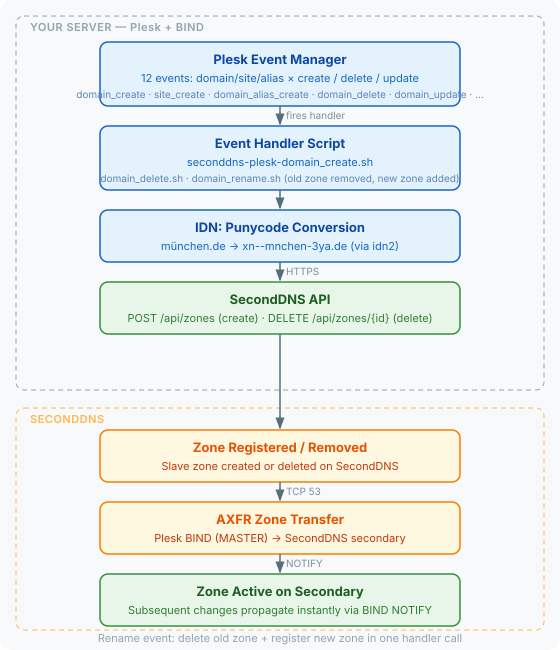

# SecondDNS — Plesk Hosting Panel Integration

Automatic secondary DNS for Plesk servers. Uses Plesk Event Manager to sync domain creation, deletion, rename, and domain aliases to SecondDNS via API + AXFR.

Tested on Plesk Obsidian 18.0.77.2 (Ubuntu 24.04).

## How It Works



Three shell scripts are registered as Plesk event handlers for 12 events:

1. **Domain/alias created** — calls SecondDNS API to register the zone
2. **Domain/alias deleted** — removes the zone from SecondDNS
3. **Domain/alias renamed** — removes the old zone and registers the new one

After zone registration, SecondDNS pulls the full zone via AXFR. Subsequent changes propagate via BIND NOTIFY.

Handles all Plesk domain types: default domains (first in subscription), additional domains, and domain aliases.

## Internationalized Domain Names (IDN)

The integration supports IDN domains (e.g. `каба-жаба.укр`, `münchen.de`, `中国.cn`).

For best results, IDN domains should be converted to Punycode format (e.g. `xn----7sbabacd2b5a.xn--j1amh`) before being synced to SecondDNS.

**IDN utilities:**
- The installer attempts to install `idn2` (or `idn` as fallback) for automatic Punycode conversion
- If installation fails, domains will still be synced but may not be converted
- **For systems without idn2/idn:** Install manually using:
  - Debian/Ubuntu: `apt-get install idn2`
  - AlmaLinux/Rocky (dnf): `dnf install idn2`
  - RHEL/CentOS (yum): `yum install idn2`
  - Alpine: `apk add libidn2-tools`
  - Other distributions: search for `idn2` package

## Requirements

- Plesk Obsidian (18.x+)
- Root access
- BIND as DNS server
- TCP port 53 open to SecondDNS
- SecondDNS API key (get one at seconddns.com/dashboard/api-key)

## Installation

```bash
curl -sL https://raw.githubusercontent.com/seconddns/dns_integrations/main/hosting-panels/plesk/install.sh | bash -s -- --api-key=YOUR_API_KEY
```

The installer:
- Verifies the API key
- Detects server IP (IPv4/IPv6)
- Installs event handler scripts to `/usr/local/bin/`
- Registers 12 Plesk event handlers via CLI
- Replaces default `ns2.<domain>` with secondary nameserver in DNS template
- Configures BIND for AXFR (allow-transfer, also-notify)
- Offers to sync existing domains

### Options

| Flag | Description |
|---|---|
| `--api-key=KEY` | SecondDNS API key (required) |
| `--api-url=URL` | API base URL (default: `https://seconddns.com`) |
| `--master-ip=IP` | Primary DNS IP (default: auto-detect) |
| `--yes` | Skip confirmation prompts |

## AXFR Configuration

Plesk writes `allow-transfer { common-allow-transfer; };` into every zone, so `allow-transfer` in the BIND `options` block (or in **Server-wide Settings → Additional DNS settings**, which lands there) does not open transfers for Plesk zones. The ACL `common-allow-transfer` is what counts. Plesk builds it from **Tools & Settings → DNS Settings → Transfer Restrictions Template** and keeps it across config regeneration.

The installer adds the SecondDNS addresses to that template, after asking:

```bash
plesk bin server_dns -u -add-acl SECONDARY_IP[,SECONDARY_IPV6]
```

It skips addresses already listed and checks that they appear in `acl common-allow-transfer` in `named.conf`. On Plesk 18.0.81 the call rewrites `named.conf` and reloads named immediately. If an address does not show up, the installer says so; add it in **Transfer Restrictions Template** by hand.

NOTIFY is not set per zone, so the server-wide settings do reach it. For instant updates, add this to **Server-wide Settings → Additional DNS settings**:

```
also-notify { SECONDARY_IP; };
```

The uninstaller does not remove the addresses from the Transfer Restrictions Template (`server_dns` has no command for it): remove them there by hand.

## TSIG-signed transfers

Instead of our IP address, zone transfers can be authenticated with a TSIG key. Create the key in the SecondDNS dashboard (**Settings → DNS**), then either answer **2** at the installer prompt or pass it directly:

```bash
install.sh --api-key=YOUR_API_KEY --tsig=KEY:SECRET          # KEY = label or full name
seconddns-tsig enable --tsig=KEY:SECRET                       # on an existing install
```

What `seconddns-tsig enable` does on Plesk:

1. Writes the key to `/var/named/chroot/etc/seconddns-tsig.key` (0640, named's group) and includes it as `/etc/seconddns-tsig.key` in the custom directives block of `named.conf`, which Plesk keeps.
2. Adds `key "<name>";` to `acl common-allow-transfer`, the list every Plesk zone uses, next to our IPs.
3. Sets the key on this server's zones in SecondDNS. Only then our IPs leave the ACL, so no transfer is ever refused.
4. Installs `seconddns-tsig-restore.path` (watches `named.conf`) and `seconddns-tsig-restore.timer` (every 5 minutes).

Plesk rewrites `acl common-allow-transfer` from the Transfer Restrictions Template whenever it rebuilds the DNS configuration. That drops the key from the ACL and brings our IPs back. The path unit runs `seconddns-tsig restore` within seconds and puts it right. In between, SecondDNS's signed requests still pass: named keeps knowing the key through the include in the custom directives block, and our IP is back in the ACL. If Plesk ever rewrites the custom block as well, named no longer knows the key and signed transfers are refused (BADKEY) until `restore` runs; the secondary retries on its schedule. To keep our IPs out of the template for good, remove them in **Tools & Settings → DNS Settings → Transfer Restrictions Template**.

`seconddns-tsig status` shows the key in use; `seconddns-tsig disable --zones` goes back to transfers by IP (the uninstaller runs it first).

## DNS Template

The installer automatically:
- Adds the secondary nameserver (e.g. `ns2.seconddns.com`) to the DNS zone template
- Offers to remove the default `ns2.<domain>` record (which points to the same server and provides no redundancy)

> **Note:** The automatic replacement may not always succeed. After installation, verify the template manually using the steps below.

**Step 1 — Verify NS records (Zone Records Template):**

1. Go to **Tools & Settings** → **DNS Settings** → **Zone Records Template**
2. Check the NS records. If a record with value `ns2.<domain>.` still exists, replace it with the SecondDNS nameserver shown in your SecondDNS dashboard (e.g. `ns2.seconddns.com.`)

To inspect the current template records via CLI:

```bash
plesk db "SELECT val FROM dns_recs_t WHERE type='NS'"
```

**Step 2 — Set the primary nameserver (Zone Settings Template):**

1. Go to **Tools & Settings** → **DNS Settings** → **Zone Settings Template**
2. Find **Primary Name Server** and change it from `(Autoselect)` to `ns1.<domain>.`

This ensures the SOA MNAME points to your Plesk server, not the secondary. Without this, the SOA primary nameserver field may be set to `ns2.seconddns.com.`, which is incorrect.

For existing domains, add the NS record through each domain's DNS settings or use the Plesk mass update feature.

## Verification

```bash
# Check registered handlers (should show 12)
plesk bin event_handler --list | grep seconddns

# Watch the log
tail -f /var/log/seconddns.log

# Compare SOA on both nameservers
dig @your-server-ip example.com SOA +short
dig @ns2.seconddns.com example.com SOA +short
```

## Supported Events

| Plesk Event ID | Description | Action |
|---|---|---|
| `domain_create` | Default domain (first in subscription) created | Add zone |
| `site_create` | Additional domain created | Add zone |
| `domain_alias_create` | Default domain alias created | Add zone |
| `site_alias_create` | Domain alias created | Add zone |
| `domain_delete` | Default domain deleted | Remove zone |
| `site_delete` | Additional domain deleted | Remove zone |
| `domain_alias_delete` | Default domain alias deleted | Remove zone |
| `site_alias_delete` | Domain alias deleted | Remove zone |
| `domain_update` | Default domain updated (fires on rename) | Remove old zone, add new zone |
| `site_update` | Additional domain updated (fires on rename) | Remove old zone, add new zone |
| `domain_alias_update` | Default domain alias updated (fires on rename) | Remove old zone, add new zone |
| `site_alias_update` | Domain alias updated (fires on rename) | Remove old zone, add new zone |

## Troubleshooting

**Zone not appearing on secondary:**
Check `/var/log/seconddns.log`. Verify event handlers are registered:
```bash
plesk bin event_handler --list | grep seconddns
```

**AXFR refused:**
Make sure AXFR is configured both in `named.conf.options` and in Plesk UI (Tools & Settings → DNS Settings → Server-wide Settings → Additional DNS settings).

**Timeout:**
Verify TCP port 53 is open between your server and SecondDNS. AXFR uses TCP.

**Duplicate handlers after re-install:**
The installer removes existing SecondDNS handlers before registering new ones. If you see duplicates, run the uninstaller first, then re-install.

**IDN domain not syncing:**
Verify `idn2` (or `idn`) is installed: `which idn2` or `which idn`. If not found, run the installer again or manually install `libidn2-bin` (Debian) / `libidn2` (RHEL).

Check the log for the Punycode-converted domain name:
```bash
tail -f /var/log/seconddns.log | grep "Zone created"
```
IDN domains should appear as `xn--...` in the logs.

**Test handler manually:**
```bash
NEW_DOMAIN_NAME=example.com bash -c /usr/local/bin/seconddns-plesk-domain_create.sh
OLD_DOMAIN_NAME=old.com NEW_DOMAIN_NAME=new.com bash -c /usr/local/bin/seconddns-plesk-domain_rename.sh
```

For IDN testing:
```bash
NEW_DOMAIN_NAME=каба-жаба.укр bash -c /usr/local/bin/seconddns-plesk-domain_create.sh
```

## Uninstall

```bash
curl -sL https://raw.githubusercontent.com/seconddns/dns_integrations/main/hosting-panels/plesk/uninstall.sh | bash
```

Removes event handlers, scripts, and config. Zones on the secondary are not deleted automatically.

## Files

| Path | Description |
|---|---|
| `/etc/seconddns.conf` | API credentials and master IP |
| `/usr/local/bin/seconddns-plesk-domain_create.sh` | Domain creation handler |
| `/usr/local/bin/seconddns-plesk-domain_delete.sh` | Domain deletion handler |
| `/usr/local/bin/seconddns-plesk-domain_rename.sh` | Domain rename handler |
| `/var/log/seconddns.log` | Integration log |
